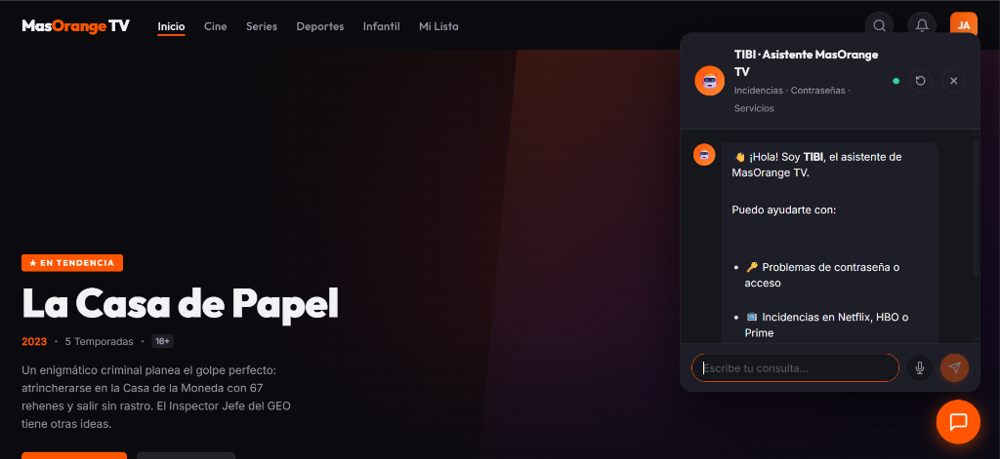
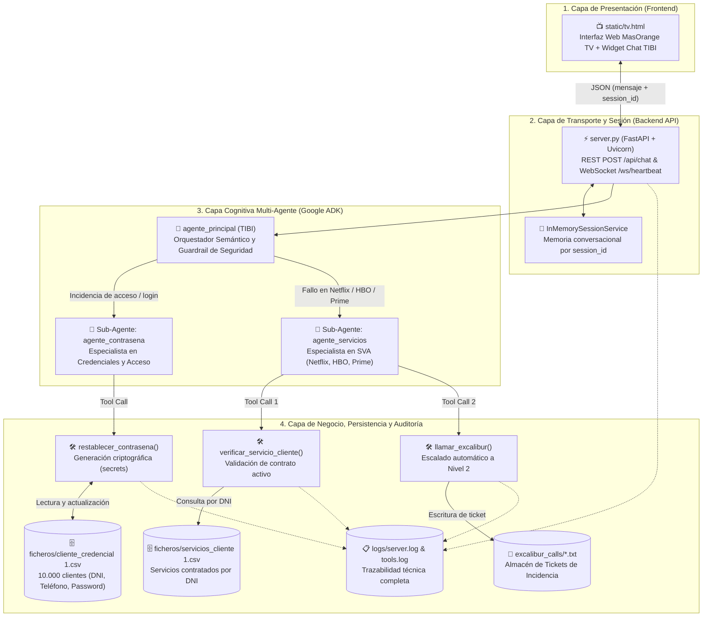
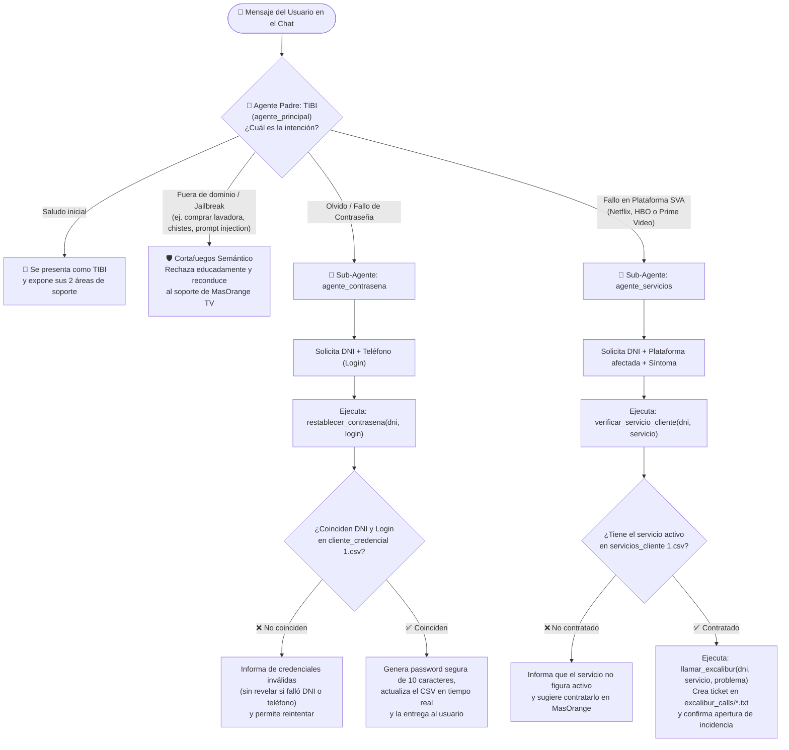

# 🤖 TIBI — Sistema Multi-Agente IA para Resolución de Incidencias en MasOrange TV



> **Trabajo de Fin de Grado (TFG)** — Arquitectura de Software Basada en Agentes Inteligentes (*Google Agent Development Kit + FastAPI*)  
> 📄 **Guía de Pruebas para Defensa / Demo**: Consulta el documento [**`CASOS_DE_PRUEBA_DEMO.md`**](CASOS_DE_PRUEBA_DEMO.md) con todos los escenarios de uso y clientes preseleccionados listos para copiar y pegar.

---

## 1. Visión General del Proyecto

**TIBI** es un sistema conversacional **Multi-Agente** diseñado para automatizar el soporte técnico de primer y segundo nivel en la plataforma **MasOrange TV**. A diferencia de un chatbot tradicional basado en árboles de decisión rígidos o de un único prompt monolítico, TIBI implementa el patrón de diseño **Orquestador-Especialistas (*Router-Specialist Multi-Agent Pattern*)** combinado con **Ejecución Determinista de Herramientas (*Tool Calling*)** y **Trazabilidad Completa de Auditoría**.

### Pilares de Ingeniería del Software (Justificación Académica)

| Principio de Diseño | Implementación en TIBI | Ventaja frente a un enfoque monolítico |
| :--- | :--- | :--- |
| **Separación de Responsabilidades (*SoC*)** | División estricta en 4 capas independientes: Presentación (`static/`), API (`server.py`), Cognitiva (`app/`) y Datos/Herramientas (`tools/` + `ficheros/`). | Permite sustituir la base de datos (CSV $\rightarrow$ SQL/BigQuery) o el frontend sin tocar una sola línea de los agentes de IA. |
| **Orquestación Jerárquica Multi-Agente** | Un agente raíz (`agente_principal`) actúa como *router* semántico y cortafuegos, delegando en dos sub-agentes especialistas (`agente_contrasena` y `agente_servicios`). | Reduce drásticamente las alucinaciones del LLM al acotar el contexto y las herramientas (*tools*) visibles por cada sub-agente. |
| **Cero Acceso Directo del LLM al Dato (*Deterministic Tooling*)** | Los agentes no leen ni editan los CSV libremente; invocan funciones Python tipadas (`tools/tools.py`) que validan credenciales, mutan datos de forma atómica y generan contraseñas con entropía criptográfica (`secrets`). | Garantiza integridad transaccional y evita fugas de datos o corrupciones en la base de datos de clientes. |
| **Auditoría y Escalado (*Human-in-the-Loop*)** | Generación automática de tickets persistentes en `excalibur_calls/` y logs estructurados en `logs/`. | Cumple con los estándares reales de teleco donde toda incidencia de Nivel 2 deja un rastro auditable de quién solicitó qué y cuándo. |
| **Agnosticismo del Proveedor LLM** | Detección dinámica en `app/agent.py` entre **Google Gemini** (nativo ADK), **Groq (Llama 3.3 70B)** y **Anthropic Claude** (LiteLLM). | Permite ejecutar el proyecto **100% gratis** en cualquier portátil personal sin depender de redes corporativas ni tarjetas bancarias. |

---

## 2. Arquitectura del Sistema y Pipeline de Datos

El siguiente diagrama ilustra la arquitectura *End-to-End* del proyecto, desde la interfaz de usuario hasta la capa de persistencia y auditoría:



---

## 3. Árbol de Decisión del Sistema Multi-Agente

El comportamiento del agente padre (`agente_principal`) y su delegación hacia los sub-agentes sigue un flujo determinista gobernado por instrucciones de sistema (*System Prompts*) y restricciones de seguridad (*Guardrails*):



---

## 4. Estructura del Repositorio (Explicación Fichero a Fichero)

```text
TIBI_AgenteIA/
│
├── app/                              # 🧠 CAPA COGNITIVA (Google ADK)
│   ├── __init__.py                   # Expone el módulo de agentes al servidor
│   └── agent.py                      # Definición de los 3 agentes (Prompts, Modelos y Orquestación)
│
├── tools/                            # 🛠️ CAPA DE LÓGICA DE NEGOCIO (Tool Calling)
│   ├── __init__.py                   # Exporta las herramientas autorizadas
│   └── tools.py                      # Funciones Python que leen/escriben los CSV y generan tickets
│
├── ficheros/                         # 🗄️ CAPA DE DATOS (Simulación de BBDD en Local)
│   ├── cliente_credencial 1.csv      # 10.000 registros de usuarios (DNI, login telefónico, contraseña)
│   └── servicios_cliente 1.csv       # Matriz de servicios SVA contratados por cada DNI
│
├── excalibur_calls/                  # 📄 AUDITORÍA DE INCIDENCIAS (Tickets Nivel 2)
│   └── excalibur_YYYYMMDD_HHMMSS_DNI.txt  # Ficheros generados automáticamente al escalar fallos SVA
│
├── logs/                             # 📋 TRAZABILIDAD TÉCNICA
│   ├── server.log                    # Registro de peticiones HTTP, sesiones y latencias
│   └── tools.log                     # Registro de llamadas a herramientas y cambios en CSV
│
├── static/                           # 🖥️ CAPA DE PRESENTACIÓN (Frontend)
│   ├── tv.html                       # Interfaz SPA de MasOrange TV + Widget conversacional TIBI
│   └── captura_interfaz_tibi.png     # Captura oficial de la interfaz desplegada
│
├── server.py                         # ⚡ BACKEND API (FastAPI + Runner asíncrono de Google ADK)
├── instalador.py                     # ⚙️ Asistente interactivo de instalación y configuración de API Key
├── instalar.bat                      # Script one-click de instalación para Windows
├── iniciar.bat / Iniciar TIBI.bat    # Lanzadores automáticos del servidor + apertura del navegador
├── requirements.txt                  # Dependencias fijadas del proyecto (FastAPI, Google ADK, LiteLLM)
├── .env.example                      # Plantilla de configuración (Gemini / Groq / LiteLLM)
├── README.md                         # Documentación arquitectónica y guía de despliegue (este archivo)
├── CASOS_DE_PRUEBA_DEMO.md           # Matriz exhaustiva de casos de prueba con datos reales de los CSV
└── Presentacion_TFG_TIBI_Orange.pptx # Presentación oficial del proyecto (Estándar Visual Orange 2026)
```

---

## 5. Despliegue en Portátil Personal (100% Gratis y Sin Tarjeta Bancaria)

El proyecto está preparado para ejecutarse en cualquier ordenador personal **fuera de la red de la empresa** y de forma **totalmente gratuita**, sin necesidad de introducir datos bancarios ni suscribirse a pruebas de pago.

### Paso 1: Obtener una API Key 100% Gratuita (30 segundos)

Puedes elegir cualquiera de estos dos proveedores gratuitos sin tarjeta de crédito:

1. **Opción A — Google AI Studio (Recomendada, nativa de Google ADK)**:
   - Entra con cualquier cuenta de Gmail personal en: 👉 **[https://aistudio.google.com/apikey](https://aistudio.google.com/apikey)**
   - Pulsa en **"Create API key"**.
   - Copia la clave generada (empieza por `AIzaSy...`). *No solicita tarjeta bancaria ni facturación.*
2. **Opción B — Groq Cloud (Alternativa ultrarrápida con Llama 3.3 70B)**:
   - Entra en: 👉 **[https://console.groq.com/keys](https://console.groq.com/keys)**
   - Crea una cuenta gratuita y genera una API Key (empieza por `gsk_...`).

### Paso 2: Clonar e Instalar en Windows

Abre una terminal en tu portátil personal y ejecuta:

```powershell
git clone https://github.com/DanielBraun11/TIBI_AgenteIA.git
cd TIBI_AgenteIA
```

Haz doble clic en **`instalar.bat`** (o ejecútalo desde la terminal):
1. Creará automáticamente el entorno virtual `.venv` con Python 3.11+.
2. Instalará todas las dependencias de `requirements.txt`.
3. Te pedirá por pantalla tu API Key (`AIzaSy...` o `gsk_...`) y creará automáticamente el archivo `.env`.

### Paso 3: Iniciar la Demo

Haz doble clic en **`Iniciar TIBI.bat`** (o `iniciar.bat`).
- El servidor FastAPI arrancará en `http://localhost:8000`.
- Se abrirá automáticamente tu navegador con la interfaz de **MasOrange TV** y el asistente **TIBI** listo para la demostración en vivo.
